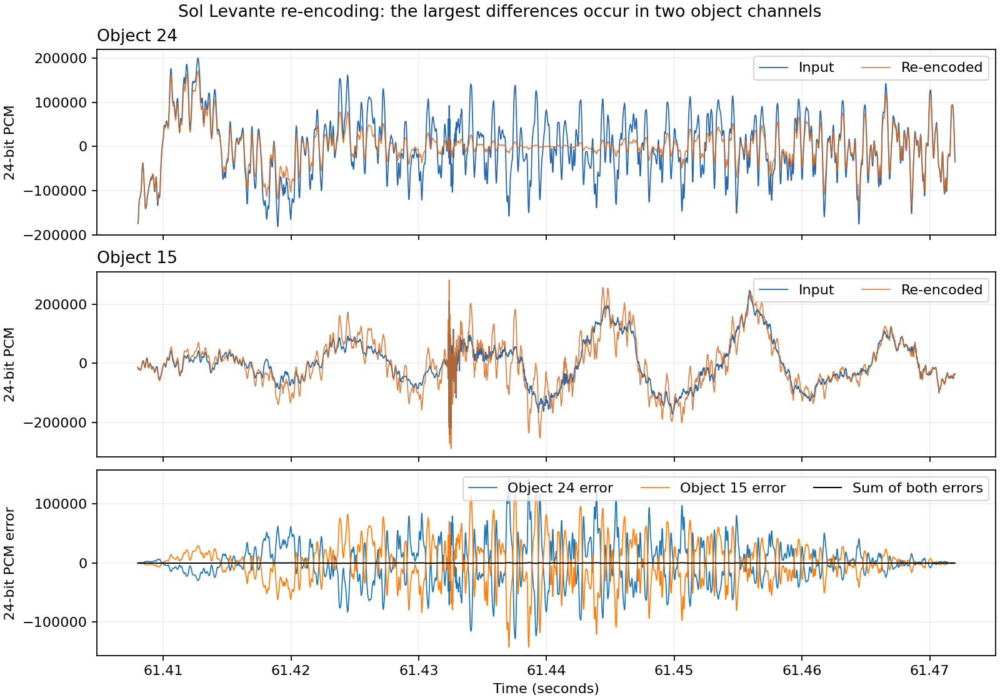
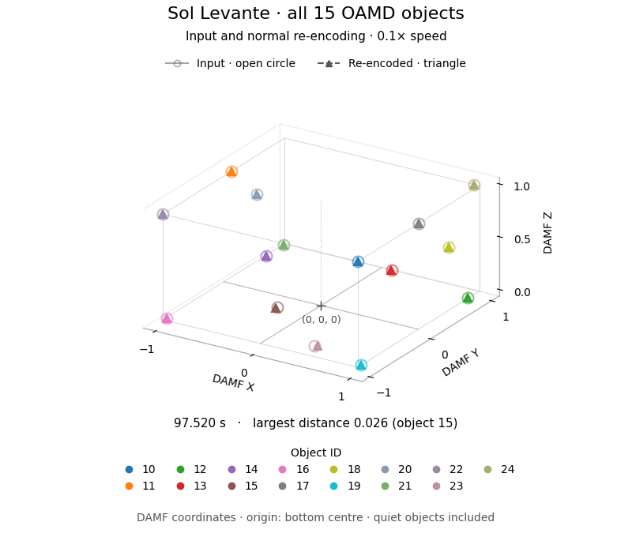

# dthd-mac2linux

Build the macOS x86-64 `dee_dthd_encoder` as a Linux ELF executable.
`dthd-mac2linux` builds the executable; `dthd-darwin-abi` contains the runtime compatibility code.
You supply the Dolby payload, Linux MediaInfo library and valid license.
Tested with DEE 6.7.0+8e353f99. Other versions need testing.

Copyright 2026 Rainbaby. Code licensed under [Apache-2.0](LICENSE).

## Build

Build on Ubuntu 24.04 x86-64 with Rust 1.97.1 from `rust-toolchain.toml`.
The pinned toolchain uses GCC/G++ 13.3, binutils 2.42, glibc 2.39 and LLVM 18.1.3.
Exact versions and input hashes are in [config/inputs.lock](config/inputs.lock).
Run commands from a Git checkout with its release tags.

```sh
sudo apt-get install build-essential binutils git curl xz-utils ca-certificates
```

Generate the Unicode snapshot on macOS 26.6.2, then copy it to Linux:

```sh
cargo run --locked --release -- textmap inputs/textmap.c.inc
```

On Linux:

```sh
cargo run --locked --release -- fetch-sources inputs/sources
cargo run --locked --release -- build \
  --payload /path/to/dee_dthd_encoder --sources inputs/sources \
  --textmap /path/to/textmap.c.inc --verify
```

`--verify` compares two isolated builds. `dist/` contains the executable,
symbol binary, checksums and `BUILDINFO.json`. Place the executable beside
Linux DEE's `libmediainfo.so.0` and `license.lic`. The executable requires glibc 2.39
or newer.

Use `--allow-unpinned-payload` to try another encoder payload. It must pass
`check-payload` screening; encoding still needs validation. Source archives and
the Unicode snapshot remain pinned. `BUILDINFO.json` records the actual payload hash.

## Validation

Encoding comparisons use the public [Sol Levante DAMF](https://opencontent.netflix.com/)
(Netflix and Production I.G, 2020; [CC BY 4.0](https://creativecommons.org/licenses/by/4.0/)),
with 16 elements, `legacy_authoring=0` and `skip:dialnorm=-31`.
We compare the 16-channel presentation and OAMD from macOS and Windows DEE 6.7
and this Linux port, decoded in strict mode. Encoded files can differ between runs.

### Master preprocessing

The full 263.08-second master requires clustering into 16 elements and metadata
smoothing. These runs use normal preprocessing. The macOS/Windows comparison
shows differences between the native encoders; Linux matches macOS exactly.
Audio differences are in 24-bit PCM units. Means use all samples and channels.

| Difference | Linux / macOS | macOS / Windows |
|---|---:|---:|
| PCM max absolute | 0 | 16 |
| PCM mean absolute | 0 | 0.000161 |
| PCM RMS | 0 | 0.050752 |
| PCM samples differing | 0% | 0.001006% |
| OAMD | Identical | Identical |

### Re-encoding decoded input

All three encoders use the same decoded Sol Levante input: LFE plus 15 objects,
with metadata aligned to frames. An unpublished test shim turns off clustering,
smoothing and noise shaping, and corrects PCM scaling and timing. We compare the
output with the input, using the same channel mapping for audio and OAMD IDs.

| Difference from input | Linux / macOS / Windows | All three, with shim |
|---|---:|---:|
| PCM max absolute | 143040 | 0 |
| PCM mean absolute | 4.674614 | 0 |
| PCM 99.9th percentile absolute | 32 | 0 |
| PCM RMS | 190.843884 | 0 |
| PCM RMS (dBFS) | -92.86 | −∞ |
| PCM samples differing | 23.995806% | 0% |
| OAMD events changed | 15,279 | 0 |
| OAMD events added | 3,962 | 0 |
| OAMD events removed | 288 | 0 |

99.80% of squared PCM error is in the 64 ms from 61.408 to 61.472 seconds.



Input and normal re-encoding for objects 24 and 15.
The bottom plot shows each object's PCM error and their sum.

Changed OAMD events have the same object ID and sample timestamp but different
positions. The input has 32,579 events.



Input and normal re-encoding, 97.520–98.000 s at 0.1× speed.
DAMF origin: bottom centre.
